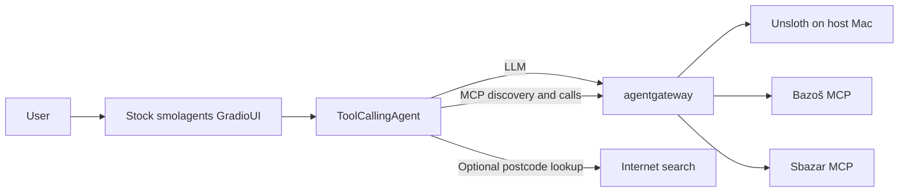

# Marketplace AI Agent

A web-only marketplace assistant using **smolagents ToolCallingAgent** and its built-in
**GradioUI**. The model chooses native tool calls; Python executes discovered MCP tools
through agentgateway and returns their real observations to the model. No custom frontend,
interactive CLI, JavaScript build, database, cloud model or code-execution agent is used.

## Start from VS Code

1. Open the repository root (`agents-course-laba`, the folder containing `01/`) in VS Code.
2. Start Docker Desktop. Keep the existing Unsloth Studio API running with the configured
   model loaded; the project never installs, downloads or starts a model.
3. Keep your existing `01/.env`. On first setup only, copy `01/.env.example` to `01/.env`
   and configure `UNSLOTH_BASE_URL`, `UNSLOTH_MODEL` and, if required, `UNSLOTH_API_KEY`.
4. Open **Run and Debug**, select **Marketplace: Start Web UI**, then press **▶ / F5**.

VS Code builds/starts Compose, waits for readiness and opens Chrome at
**http://localhost:8080**. Stopping that debug session runs `docker compose stop` for this
project. Chrome is used by VS Code's built-in browser debugger; no frontend tooling or
additional VS Code extension is required for this launch profile. If you change `APP_PORT`,
update the URL in `.vscode/launch.json` too.

Available VS Code tasks: **Marketplace: Start**, **Marketplace: Stop**, **Marketplace: Tests**.
The test task additionally requires local [uv](https://docs.astral.sh/uv/).

## Start without VS Code

```bash
cd 01
docker compose up -d --build --wait
# Open http://localhost:8080 in your browser.
docker compose logs -f app
docker compose stop
```

The existing four services remain `app`, `agentgateway`, `bazos-mcp` and `sbazar-mcp`.
`app` serves the standard smolagents Gradio UI on port 8080. Its healthcheck requests the
actual UI page; it does not infer anything about model/source availability. The separate
gateway diagnostics panel remains at http://localhost:3002/ui/.

For local Python development, use the running gateway's published ports:

```bash
cd 01
uv sync --locked
LLM_BASE_URL=http://127.0.0.1:3001/v1 \
AGENTGATEWAY_URL=http://127.0.0.1:3000/mcp \
APP_HOST=127.0.0.1 APP_PORT=8081 uv run --locked python -m marketplace_agent
```

This starts the same web UI at http://localhost:8081. There are no `chat`, `search`,
`doctor`, `serve`, `tools` or `version` application commands. All interaction is through
GradioUI. Use **New chat** to reset agent memory. The standard UI shows actual agent/tool
steps and the final answer. It is a local, single-agent development UI, not a multi-user
application; its standard browser history behavior comes from Gradio.

## Example searches

- `Najdi iPhone 15 do 12000 Kč. Prohledej oba bazary.`
- `Najdi MacBook Air M2 od 10000 do 18000 Kč. Nechci pouzdra ani náhradní díly.`
- `A teď jen Bazoš v okolí PSČ 46001 do 30 km.`
- `Najdi iPhone 15 do 12000 Kč do 30 km od Liberce 1, jen Bazoš.`
- `Seřaď od nejlevnějších, nejvýše 5 výsledků.`

The existing MCP tools accept **postcodes**, not town names. When only a town/district is
provided, the model can call `lookup_postcode`, based on smolagents' built-in web search.
An unambiguous postcode found in search snippets can be used with its source link. Multiple
matches or a failed lookup require a district/address or PSČ; guessed codes remain blocked.
No new service or API key is needed. Both marketplaces use native radius filters. Sbazar
resolves the postcode to its first municipal suggestion; postal areas can cover multiple
places. Exact listing distances remain unverified and warnings stay visible.
Shared price filtering, global sorting, URL deduplication
and final limits apply to the combined retrieved results; fetched pages are not the whole market.

Public, bounded searches requested by the user are **enabled by default**. The legacy
`BAZOS_ACCESS_PERMITTED` and `SBAZAR_ACCESS_PERMITTED` flags are source toggles; set either
to `false` to disable requests. robots.txt is not used as an application access gate.
HTTP 403/429, timeouts and access challenges are reported without bypasses or retries.
An empty tool response with an error warning is incomplete, not proof of no matches.
See [Bazoš MCP](docs/bazos-mcp.md) and [Sbazar MCP](docs/sbazar-mcp.md).

`AGENT_MAX_ITERATIONS` defaults to **20**. Each selected marketplace is called at most once
per user turn, with identical search parameters across steps. Warnings/errors finish that
source's attempt; the agent preserves the requested location, radius and price filters.
After all selected sources respond, only native `final_answer` remains available.

## Architecture



Marketplace tools must be approved and runtime-discovered. The only additional search tool
is `lookup_postcode`; it queries the web directly, while marketplace traffic stays on MCP.
`CodeAgent`, Python execution and unrelated tools are disabled. The model adapter rejects prose-to-tool
fallbacks. smolagents handles the orchestration and final-answer protocol; a small search
wrapper validates the existing schemas and combines actual results. See
[agent implementation](docs/agent.md), [architecture](docs/architecture.md) and
[gateway configuration](docs/agentgateway.md).

## Tests

```bash
cd 01
uv run --locked pytest
uv run --locked ruff check .
uv run --locked ruff format --check .
GATEWAY_DOCKER_TESTS=true uv run --locked pytest tests/integration/test_agentgateway.py
AGENT_LIVE_E2E=true \
LLM_BASE_URL=http://127.0.0.1:3001/v1 AGENTGATEWAY_URL=http://127.0.0.1:3000/mcp \
uv run --locked pytest tests/integration/test_agent_live.py -s
```

Default tests use fake model responses and mocked MCP results with the real smolagents
loop, including postcode evidence, ambiguous matches and lookup failures. Optional Docker
tests use the pinned gateway and fixture marketplaces. The live
test uses the actual loaded Unsloth model and actual MCP servers; source warnings and
retrieved listing counts are reported honestly. A fixture test is not proof of live marketplace access.
For the optional native postcode-lookup cycle, set `POSTCODE_LIVE_E2E=true` instead of
`AGENT_LIVE_E2E=true` in the same live-test command; this also requires Internet access.

## Original school assignment

> 📍 Napiš Python skript, který zavolá LLM API, použije nástroj (např. výpočetní funkci) a vrátí odpověď zpět LLM.
>
> 📄 Formát: Vypracovaný úkol odevzdejte ve formě zdrojového kódu. Projekt ideálně nahrajte na Github a odevzdejte link na Github repositáře.
>
> 📅 Deadline úkolu máš do 23. 11. 2026 23:59
>
> 📍 Maximální počet bodů, které můžeš získat je 100 bodů.

## Project stages

Stages 01–04 provide packaging, both MCP services and the gateway/Unsloth routes. Stage 05
now uses smolagents and its stock web UI, with verified live marketplace retrieval.
Final demonstration and submission work remain for Stage 06.
