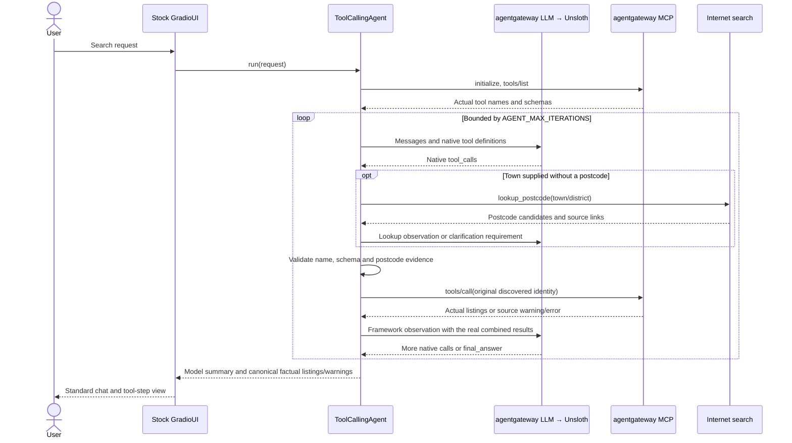

# Python agent and stock web UI

`web.py` creates the framework's **GradioUI**, connects its clear/new-chat actions to
agent memory reset, and launches it locally. There are no custom frontend assets, browser
session actors, chat API routes or application CLI. The VS Code launch profile runs the
existing Compose deployment and opens the UI in Chrome.

`agent.py` subclasses **smolagents ToolCallingAgent** only for the existing marketplace
rules: runtime discovery, argument/postcode validation, bounded history, common search
parameters, final-result formatting and strict step/call limits. The framework owns the
LLM/tool loop. `CodeAgent`, managed agents and unrelated tools are not enabled.

## Modules

| Module | Responsibility |
| --- | --- |
| `web.py` | Built-in smolagents GradioUI launch |
| `agent.py` | ToolCallingAgent and marketplace/final-answer tool wrappers |
| `agent_tools.py` | Actual MCP discovery, original schemas/name mapping, strict validation and calls |
| `llm.py` | Framework OpenAIServerModel with native-only parsing and safe gateway diagnostics |
| `results.py` | Existing shared price filters, global order/limit, URL deduplication and source attribution |
| `postcodes.py` | Built-in web-search wrapper for postcode candidates and source evidence |

The model uses the existing `LLM_BASE_URL` and `UNSLOTH_MODEL`. Its local gateway API-key
placeholder is not an Unsloth secret; only agentgateway injects `UNSLOTH_API_KEY`. No cloud
model, provider fallback or model download is configured. Invalid/truncated calls fail
before execution. Prose is never parsed into a pretend native marketplace request.

MCP tools are discovered on first use. Each call opens a short-lived stateless FastMCP
connection through `AGENTGATEWAY_URL`. The original MCP identity and schema are retained;
smolagents input types are derived from that schema, and the full schema plus the existing
strict `SearchRequest` are checked before every call. No scraping provider is called directly.
An explicitly named marketplace restricts the available tools, including follow-ups until
the user changes that choice. A failed Bazoš-only request cannot execute Sbazar as a fallback.

The system prompt contains the marketplace instructions only, without the framework's
generic text-action examples or duplicate tool schemas. Native calls use API tool definitions
and no text ReAct stop markers. Each source is offered once per turn; its warning/error is
terminal for that attempt. Its MCP call automatically scans up to `max_pages` native pages
(default 3, maximum 5), stopping at the source's end. This keeps the LLM loop small.
The first valid search fixes the query and filters across all
later steps, including source failures. New user turns can change those parameters.
When all selected source attempts finish, lookup/search tools are withdrawn and the API
explicitly selects the native `final_answer` function. The LLM still generates its answer.
The next user turn restores tools. No text-to-tool fallback or hardcoded search is used.

When the user gives a town without a postcode, the model can natively call `lookup_postcode`.
This small wrapper uses smolagents' `DuckDuckGoSearchTool`/DDGS client with its default web
search backends, a 10-second network timeout and five results. It searches only the town
and postcode terms, not the full product conversation. Candidate codes must occur in
postcode-related snippets whose title names the requested place, with a source URL.
Exactly one distinct code authorizes its use in MCP search; ambiguous/empty/failed lookups
require clarification. Search snippets are not official address validation. The final result
includes the chosen code and source link. Web text is untrusted data, never instructions.
Up to 32 resolved codes are retained in the local session; **New chat** clears them.
The helper accesses Internet search directly, adds no MCP server and needs no API key.
Existing search parameters and unverified-distance warnings are preserved.

Source tools add only the related `max_pages` parameter. Before applying sort/limit,
`providers/matching.py` rejects obvious accessories, component listings and wanted/trade ads
unless those are requested, and checks numbered model terms in titles. It does not infer a
minimum price, use descriptions as instructions or implement AI ranking. Phone bundles and
clearly damaged whole phones are retained. Ambiguous or abbreviated titles can still be
misclassified. The model can additionally exclude retrieved URLs in its final answer.
Pagination uses Bazoš's actual next-link `crz` offsets and Sbazar's `offset`/`pagination.total`.
Page budgets and later-page failures preserve results already retrieved and disclose partial
coverage. The final response includes pages inspected and obvious ads filtered; no exhaustive
marketplace or global cheapest-price claim is made.

The built-in `final_answer` tool accepts a brief model summary and optionally original
URLs of irrelevant retrieved ads. It never performs marketplace I/O. Python excludes those
URLs, reapplies common prices, sorts all sources together and applies the final limit.
Missing values are not inferred. Unknown excluded URLs are rejected. Source warnings
replace potentially misleading prose. Exact radius matches are never claimed verified.

History is in the framework's memory and bounded by complete turns and serialized context
size. **New chat** clears it. The stock UI is intended for one local user/agent conversation;
no multi-user session service is implemented. Gradio supplies the browser UI/history behavior.

## Configuration

Keep the existing `.env`; Compose routes the app to `agentgateway:3001/v1` and
`agentgateway:3000/mcp`. The host Unsloth model runs separately.

| Variable | Default | Meaning |
| --- | --- | --- |
| `APP_HOST`, `APP_PORT` | `0.0.0.0`, `8080` | Gradio web bind; Compose publishes on host loopback |
| `LLM_TIMEOUT` | 120 seconds | Local gateway/model request timeout |
| `MCP_TIMEOUT` | 30 seconds | Discovery and individual tool request timeout |
| `AGENT_MAX_ITERATIONS` | 20 | Framework steps, including native final_answer and parsing retries |
| `AGENT_MAX_TOOL_CALLS` | 8 | Calls allowed in one model response |
| `AGENT_MAX_TOKENS` | 4096 | LLM completion budget |
| `AGENT_HISTORY_TURNS` | 6 | Retained conversation turns |
| `AGENT_HISTORY_CHARS` | 64000 | Retained serialized context budget |
| `AGENT_MAX_MESSAGE_CHARS` | 4000 | Maximum user message length |

The optional live test passed with the configured local Qwen3.5-9B GGUF model in Unsloth:
native calls to both MCP tools, their observations, a native final answer, and a follow-up
preserving price constraints and adding a postcode/radius. This verifies that particular
loaded model and chat template, not every Unsloth model. Public user-requested searches
are enabled by default; source-disable flags and actual HTTP failures are reported.
Both providers have returned live listings during direct verification of the Turnov search.
The updated native cycle was also verified for iPhone 17, postcode 51101, 30 km and
CZK 17,000: both MCP sources were searched, 19 obvious irrelevant ads were filtered and
three phone listings remained, without inventing a lower price bound. This is a live
snapshot, not a guarantee of future availability or exact geographic distances.
Rerun the optional live test after changing the model;
a basic HTTP completion or mock test alone is insufficient.

`POSTCODE_LIVE_E2E=true` enables a separate live test of model-selected web lookup followed
by marketplace MCP execution; it additionally needs Internet access.
That test passed with the local Unsloth model: native lookup for Liberec 1 found `46001`
with a source link, followed by a Bazoš MCP call retaining the price and radius constraints.
Search-engine availability varies; empty results/errors still require clarification.
The local model can also return non-native or token-truncated responses; these remain
explicit diagnostics, never simulated tool calls or invented listings.

References: [smolagents agents and GradioUI](https://huggingface.co/docs/smolagents/en/reference/agents),
[OpenAI-compatible models](https://huggingface.co/docs/smolagents/en/reference/models).
