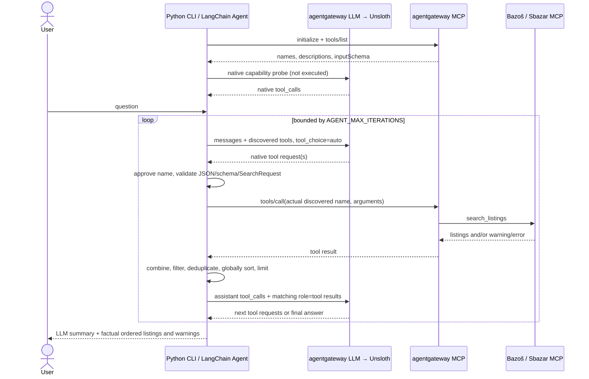

# Stage 05: Python marketplace agent

`agent.py` uses LangChain `create_agent` for the asynchronous native tool-calling loop.
All normal LLM requests use `LLM_BASE_URL` (agentgateway `/v1`) and tool discovery/execution uses
`AGENTGATEWAY_URL` (agentgateway `/mcp`). The gateway and host Unsloth setup from Stage 04
are unchanged. No model, container, server, database or scraper is added.

## Tool-calling sequence



The startup probe uses `tool_choice=required`, validates the actual returned native calls
and discards them. It never executes a probe search or inserts fake tool results.
Successful `/models` only confirms the gateway catalog; the inference probe also checks
Unsloth connectivity. A successful probe is not proof of a complete tool/result cycle.
Normal conversations use `auto`; the LLM alone decides whether/which tools to call.

## Implementation

| Module | Responsibility |
| --- | --- |
| `agent.py` | `create_agent` setup, system prompt, invocation context, session resources, bounded whole-turn history |
| `agent_runtime.py` | LangChain `StructuredTool` wrappers and `MarketplaceMiddleware`: validation, limits, aggregation and final-format correction |
| `agent_tools.py` | MCP discovery, schema conversion, name mapping, validation, MCP tools/call |
| `llm.py` | `GatewayChatModel` / `BaseChatModel` adapter, existing httpx gateway client, native parsing, probe and safe errors |
| `results.py` | Source attribution, common price range, global sort/limit/deduplication and factual rendering |
| `cli.py` | `chat`, `search`, `tools`, online/offline `doctor`, existing `version`/`serve` |

`create_agent` builds and runs LangChain's standard agent runtime. There is no handwritten
LLM/tool loop. LangGraph is a transitive runtime dependency; the application defines no
custom graph or persistent checkpointer. No LangSmith service/account is configured.
`GatewayChatModel.bind_tools` converts LangChain tools to native OpenAI-compatible
definitions and `_agenerate` uses the existing validated `GatewayLLM.complete` transport.
The model adapter supports asynchronous `ainvoke`, which is used by every CLI agent call.
No separate OpenAI SDK, OpenAI API key, model download or alternative endpoint is needed.

`marketplace_tools` creates a `StructuredTool` for each approved discovered identity.
Each wrapper calls MCP `tools/call`; a Python-only tool artifact retains the validated
search and complete payload, while only bounded content enters the LLM conversation.
`MarketplaceMiddleware` uses three hooks:

- `aafter_model` checks the per-response call budget, fixes the common batch request,
  validates the final answer, or requests one formatting correction.
- `awrap_tool_call` rejects unknown tools, invalid schemas/searches, guessed postcodes
  and conflicting batch parameters before LangChain invokes a tool. It traces actual MCP calls.
- `abefore_model` enforces the exact model-call limit, aggregates finished tool artifacts
  in request order, and adds the canonical combined view to the last `ToolMessage`.

`AgentTurn` is a fresh context object per user invocation, so search results, counters and
formatting retries never leak into the next turn. The CLI session separately retains the
existing bounded conversation history. An additional framework recursion limit bounds
internal runtime steps; `AGENT_MAX_ITERATIONS` still counts actual LLM calls.

`ToolRegistry` accepts discovered `search_listings` tools only within the Stage 04
`bazos`/`sbazar` namespaces. It never assembles an MCP identity to call. The exact name
from discovery, its source and its input schema are retained. LLM-compatible names
are identical where possible; incompatible names receive a deterministic hash alias
mapped back to the original identity. Unknown/unapproved calls cannot execute.
Input schemas become `tools[].function.parameters` without changing the MCP contract.
JSON Schema validation precedes the existing strict `SearchRequest` checks (including
postcode validation, inclusive price bounds and radius requiring a location).
The agent also verifies postcode provenance: it must occur in user input with a `PSČ`,
`postcode`, `postal code` or `ZIP` label, or as a standalone postcode message. Model text
cannot establish location provenance. A guessed town postcode is rejected before MCP
execution and the model receives an instruction to ask the user for it.

LangChain saves an `AIMessage` native call before its corresponding `ToolMessage`
response(s), each using the original `tool_call_id`. Calls in one response may execute
concurrently; completed results are aggregated in original call order rather than completion
order. The model may request further calls in later iterations. Invalid arguments/tool failures
become error results so the model can correct them or explain partial success.
Malformed call envelopes, duplicate IDs, truncated model responses and unsupported
native calling fail clearly without execution. No prose/JSON-to-tool fallback is used.

Each search group uses identical query/filters/sort/limit across sources. Conflicting
calls in a single batch receive a correction error. Sequential changes start a new
group and discard stale results, so unrelated products/filters cannot mix. Each source's
latest response replaces its earlier one. The final tool result includes the combined
view. This implementation handles one product/search group at a time.

The final model response is a small JSON envelope:
`{"answer":"summary in the user's language","exclude_urls":[]}`. This is final-answer
formatting, not a tool-calling fallback. The model can reject retrieved accessories or
irrelevant ads by original URL, but cannot insert listing records. Unknown excluded URLs
and malformed final envelopes are rejected. One formatting correction is allowed within
the normal iteration budget; this never parses prose into executable tool calls.
Python removes exclusions, deduplicates exact
URLs, reuses `providers.common.filter_and_sort`, then renders factual fields in canonical
order. No arithmetic or global sorting is delegated to the model. Semantic exclusions
still depend on model judgment and may reduce the final number of listings.
When source warnings/errors make a search incomplete, the CLI displays canonical listings
and source diagnostics instead of potentially misleading model narrative. The actual LLM
still receives the tool results and produces its final response. Successful searches and
clarifications display the model summary normally.

Advertisements are untrusted data; the system prompt instructs the model never to follow
their embedded instructions. Descriptions sent to the model are capped at 600 characters;
the CLI shows at most 240. The model supplies only a brief summary; original listing
titles/prices/source/location/URLs come from MCP. Missing values are never inferred.

## Natural-language constraints and coverage

Both sources are requested by default in the prompt. An explicit marketplace restriction
selects that source only. Product, prices and other filters are retained through complete
in-memory turns unless the user changes them. No database or persistent memory is used.
`clear` forgets all session history. Oldest complete turns are evicted by count/serialized
character budget, preserving valid assistant/tool message pairing. An oversized turn can
be evicted entirely. Failed/interrupted turns are not committed to history.

The existing tools accept only postcodes, not town names. The model must ask for a PSČ
for `Liberec` or `Praha`; it must not invent a town's postcode. Bazoš uses a source-side
radius filter but cannot verify exact distances. Sbazar returns an unsupported-filter
warning and no results for geographic searches. Such warnings remain visible, and
geographic candidates are explicitly labeled unverified. Restrictions are never silently
removed to obtain more results.

Each source fetches a bounded page. Global price sorting covers the retrieved candidates,
not the entire marketplace. Relevance preserves each source's order and source-call order
across sources; there is no cross-source relevance scoring. Live source restrictions are
unchanged. Empty listings with warnings mean an incomplete/unavailable search, not a
successful proof that no matching advertisement exists.

## Configuration

Keep the Stage 04 `UNSLOTH_MODEL` and gateway URLs. `UNSLOTH_API_KEY` stays on the gateway;
the agent never needs to send it. `LLM_MODEL` remains a legacy setting and is unused.
Inside Compose use `http://agentgateway:3001/v1` and `http://agentgateway:3000/mcp`.
For host Python use the corresponding published loopback ports instead.

| Variable | Default | Purpose |
| --- | --- | --- |
| `LLM_TIMEOUT` | 120 seconds | Per-request deadline, including inference |
| `MCP_TIMEOUT` | 30 seconds | MCP initialization, discovery and individual tool calls |
| `AGENT_MAX_ITERATIONS` | 8 | LLM responses per user turn, including final answer |
| `AGENT_MAX_TOOL_CALLS` | 8 | Maximum native calls in one LLM response |
| `AGENT_MAX_TOKENS` | 4096 | Completion budget; local reasoning may consume tokens |
| `AGENT_HISTORY_TURNS` | 6 | Retained complete turns |
| `AGENT_HISTORY_CHARS` | 64000 | Serialized retained-history character budget |
| `AGENT_MAX_MESSAGE_CHARS` | 4000 | Maximum user message size |

The current turn is bounded by call/iteration/output limits, not a tokenizer-aware context
window. Choose history/output limits appropriate for the loaded model's context capacity.
`MARKETPLACE_MODE` never selects a simulated search path or bypasses permission flags.

## CLI and Docker demonstration

Run from `01/`, keeping the existing `.env`:

```bash
docker compose up -d --build
docker compose exec app python -m marketplace_agent doctor
docker compose exec app python -m marketplace_agent doctor --offline
docker compose exec app python -m marketplace_agent tools
docker compose exec app python -m marketplace_agent chat --verbose
docker compose exec app python -m marketplace_agent search "Najdi iPhone 15 do 12000 Kč." --verbose
```

`chat` accepts `exit`, `quit`, `clear`, EOF and Ctrl+C. `search` uses the same agent and
loop, with a fresh session. `tools` requires MCP only; model availability is irrelevant.
`doctor` checks LLM and MCP independently and reports missing sources. Optional source
outages do not affect help/version/serve/offline diagnostics. The existing `app` service
continues running its health endpoint; `exec` starts an agent CLI process in that container.

Verbose mode writes actual `[LLM]` / `[MCP]` events to stderr, including discovered names,
requested calls, executed identities, listing counts and the final response. It never logs
API keys, raw model reasoning, request bodies or full tool payloads.

## Tests and actual compatibility

```bash
uv run --locked pytest
uv run --locked ruff check .
uv run --locked ruff format --check .
GATEWAY_DOCKER_TESTS=true uv run --locked pytest tests/integration/test_agentgateway.py
AGENT_LIVE_E2E=true \
LLM_BASE_URL=http://127.0.0.1:3001/v1 AGENTGATEWAY_URL=http://127.0.0.1:3000/mcp \
uv run --locked pytest tests/integration/test_agent_live.py -s
```

The default suite uses mocked LLM/MCP responses and requires no Unsloth. Docker tests
exercise the real pinned gateway, HTTP, actual MCP servers and fixture listings with an
explicitly scripted LLM on the existing isolated Stage 04 test network. The live agent
test instead uses the already running Unsloth and actual configured MCP services. It
asserts both native calls, price/sort arguments, returned tool results and a final answer;
it also checks a follow-up that retains product/price and applies a user postcode/radius
and a Bazoš-only restriction. Source warning/empty-result behavior is permitted and reported.
The orchestration tests exercise the real LangChain runtime with fake gateway responses,
including tool binding/schema preservation, native message pairing, out-of-order parallel
completion and fresh invocation context. No framework loop is mocked out.

Verified on 2026-11-07: the locally configured Unsloth model produced native tool calls
for both discovered marketplaces; the real MCP results returned through agentgateway
and the model generated a Czech final answer. Both sources had disabled live access,
returned zero listings with warnings, and were correctly reported as incomplete. This
does not establish populated live marketplace search compatibility.
The LangChain migration was also verified with the same real gateway/model/MCP cycle
and a follow-up retaining product/price while changing source and geographic filters.
The same local model sometimes guessed a town postcode despite the prompt and occasionally
missed the final JSON format. Python therefore enforces user-supplied postcode provenance
and a bounded formatting correction. Native calling works; instruction following is not
assumed reliable merely because transport/protocol tests pass.

If the probe returns prose, invalid names/arguments, HTTP 400/422, or a truncated call,
the diagnostic identifies what was observed. Check tool support in the selected model,
Unsloth's tool parser/chat template, and the gateway Chat Completions format. Transport
alone cannot distinguish every model/template problem; no diagnosis is invented.
HTTP 401/404/503/504 points to authentication, model/route, unavailable upstream or timeout
respectively. There is no automatic cloud or structured-output search fallback; a future
structured decision fallback would require separate design and verification.

Stage 06 remains unimplemented: broader final scenario validation, authorized source
access/adapter verification, populated live results where permitted, and submission/demo
finalization. This stage adds only the agent and the tests needed to verify its behavior.

The Chat Completions message/call/result format follows the official
[OpenAI function-calling documentation](https://developers.openai.com/api/docs/guides/function-calling).
Framework integration follows [LangChain agents](https://docs.langchain.com/oss/python/langchain/agents)
and [custom middleware](https://docs.langchain.com/oss/python/langchain/middleware/custom).
