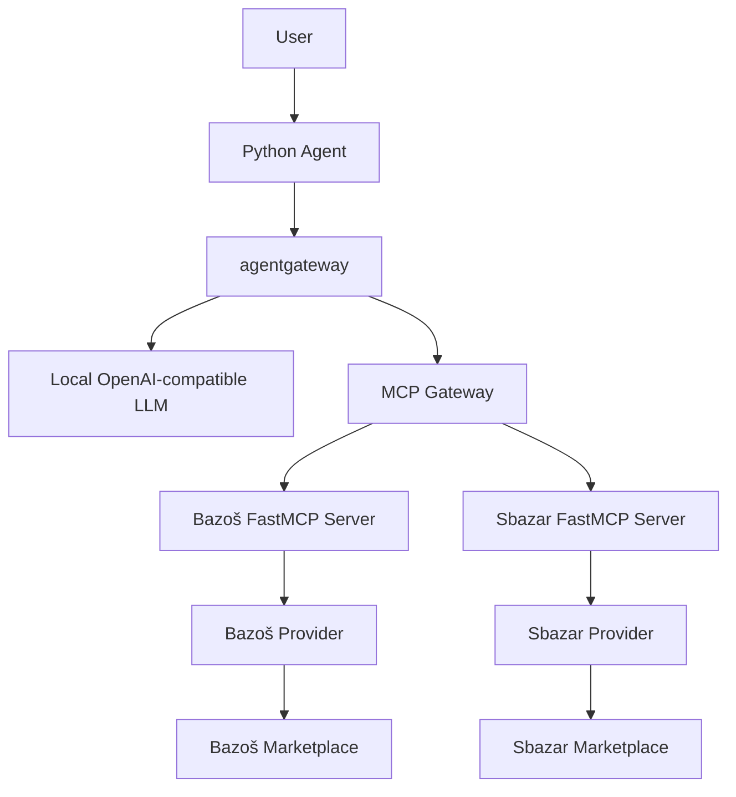

# Architecture

## Current implementation: Stages 01–02

One installable Python package contains the existing configuration/diagnostics CLI and
health server plus a separate Bazoš FastMCP service. `app` and `bazos-mcp` share the
existing multi-stage Dockerfile and locked Python dependencies. Both run as UID 10001
with Compose init and graceful termination. Only the health port is published on host
loopback; MCP is available inside Compose at `http://bazos-mcp:8001/mcp`.

The module entry point and console entry point still call `cli.main`. Pydantic Settings
validates environment variables and optional `.env`; help/version work with invalid
configuration. Package metadata supplies the version. `health.py` uses only the standard
library and handles SIGINT/SIGTERM; `/health` reports process responsiveness without
probing external services. CLI diagnostics remain independent of MCP and marketplace access.

| Module | Responsibility |
| --- | --- |
| `cli.py`, `config.py`, `health.py` | Stage 01 diagnostics, settings, health lifecycle |
| `domain/models.py` | Shared `SearchRequest` and `Listing` Pydantic models |
| `providers/bazos.py` | Independent HTTP integration, URL/card parsing, filters/sorting |
| `mcp/bazos_server.py` | Exactly one `search_listings` tool, Streamable HTTP on 8001 `/mcp` |

The provider accepts a validated request and optionally an httpx client, which makes
HTTP behavior testable without FastMCP or network access. It checks operator permission
and robots before fetching one global search page. A 15-second timeout bounds requests;
there are no retries, caching, detail-page requests, geocoding, or ranking infrastructure.
Only listing summaries are parsed. Price bounds are rechecked locally. Relevance keeps
source order; price sorting precedes the result limit. Geographic responses warn about
unverifiable exact distances and reject unconfirmed postcode/radius form values.

Live searches are currently blocked by the source policy and default to disabled.
This limitation and the current form parameters are documented in
[Bazoš MCP](bazos-mcp.md). An empty result with a warning is different from a successful
empty search. Tests use fixture HTML, httpx mocks, and MCP clients/ASGI transport.

## Planned system

The complete system remains the original roadmap. Only the Bazoš MCP/provider and the
Stage 01 CLI/health foundation are implemented. The diagram describes the future system:

The MCP Gateway node is agentgateway routing, not an additional deployment. Stage 03
will add the independent Sbazar server using the small shared models. Stage 04 will add
agentgateway, routing, and a proxy to an externally hosted OpenAI-compatible model.
Stage 05 will implement Python user interaction and the LLM/tool loop; Stage 06 will
verify the complete flow. None of these services or agent behavior exists yet.

Providers must stay independent of MCP and the future agent. Add shared services only
when concrete reuse warrants them; avoid speculative contracts and base classes.
`MARKETPLACE_MODE` remains reserved. Optional service URLs are syntax-checked but are
never probed by diagnostics. The Bazoš permission flag controls only source access.
