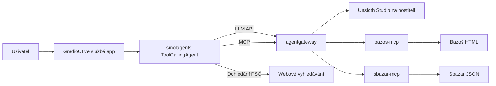

# Architektura

Projekt tvoří jeden Python balíček a čtyři služby Docker Compose.
Unsloth Studio s modelem běží samostatně na hostiteli.

## Tok požadavku

1. Agent zjistí názvy a schémata MCP nástrojů přes gateway.
2. LLM vrátí nativní `tool_calls`. Python ověří argumenty a zavolá vybraný MCP nástroj.
3. Adaptér bazaru načte omezený počet stránek a normalizuje souhrny inzerátů.
4. Skutečný výsledek nebo chyba se vrátí modelu jako výsledek nástroje.
5. LLM vytvoří shrnutí přes `final_answer`; Python připojí společně filtrovaný
   a seřazený seznam s původními odkazy a varováními.

Dohledání PSČ přistupuje k webovému vyhledávání přímo; hledání inzerátů prochází MCP.
Adaptéry bazarů jsou oddělené od agenta i transportu. Přehled modulů je v [popisu agenta](agent.md),
porty a propojení služeb v [popisu gateway](agentgateway.md).

## Společný MCP kontrakt

Oba servery poskytují `search_listings` se stejným modelem `SearchRequest`.
Neplatné vstupy jsou odmítnuty před HTTP požadavkem.

| Parametr | Význam a omezení |
| --- | --- |
| `query` | Hledaný produkt, 1–256 znaků |
| `min_price`, `max_price` | Volitelné nezáporné celé částky v Kč, včetně hranic; minimum ≤ maximum |
| `location` | Volitelné české PSČ, např. `46001` nebo `460 01`; mezera se odstraní |
| `radius_km` | 0–1000 km, vyžaduje PSČ; při samotném PSČ se použije 25 km |
| `sort_by` | `relevance` (výchozí), `price_asc`, `price_desc` |
| `limit` | 1–50 výsledků, výchozí 10 |
| `max_pages` | 1–5 stránek zdroje, výchozí 3 |

Odpověď obsahuje `query`, `count`, `listings` a případně `warning`.
Při načtení výsledků přidává `pages_scanned`, `scanned_count`, `filtered_count` a `has_more`.
Každý `Listing` obsahuje `title`, `price`, `currency`, `location`, `url`, `description`.
Neznámá cena a lokalita jsou `null`; cena se nedopočítává z textu.

## Zpracování výsledků

Společný filtr kontroluje ceny a názvy produktů, odstraňuje duplicitní URL a aplikuje řazení
před limitem. Každý zdroj nejprve vrátí vlastní omezený výběr; agent poté spojí výsledky
obou zdrojů a znovu použije společné filtry, řazení a konečný limit.
Neznámá cena neprojde zadanou cenovou hranicí, jinak se řadí na konec.
`relevance` zachovává pořadí zdrojů, nejde o společné skóre relevance.

Vyčerpání počtu stránek i selhání další stránky se projeví varováním; již načtené nabídky
se zachovají. Přesné vzdálenosti se neověřují. Rozsah a omezení řešení shrnuje [README](../README.md).
