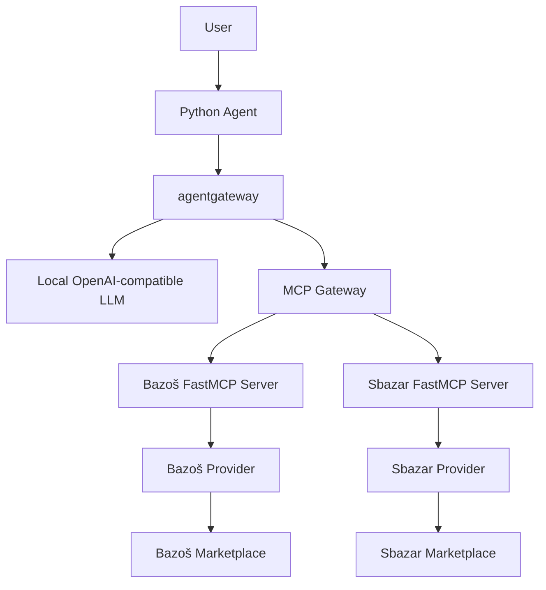

# Architecture

## Current implementation: Stage 01

One installable Python package provides configuration, diagnostics, and a health server.
The module entry point and console entry point both call `cli.main`. Configuration is
loaded only for commands that need it; `--help` and `version` work even with an invalid
environment. Pydantic Settings validates environment values and reads an optional `.env`.
Package version information comes from installed distribution metadata; `pyproject.toml`
is the single version source.

`health.py` uses the standard library instead of a web framework. `GET /health` reports
that this process is responsive. It makes no promises about future service readiness.
The main loop handles SIGINT and SIGTERM and closes its listening socket on shutdown.
Standard-library logging writes timestamp, severity, logger name, and message to stderr.
No requests, credentials, or configuration dumps are logged at startup.

The Compose deployment contains only `app`. A multi-stage Dockerfile installs locked
runtime dependencies and the package into a virtual environment, then copies that
environment into a slim Python image. Development dependencies and uv stay out of the
runtime stage. The Python and uv images support native ARM64 and AMD64; the Dockerfile
does not force an architecture. The application runs as UID 10001, with an exec-form
command and Compose's init process forwarding signals.

## Planned system

Everything in the following diagram is planned beyond the current CLI/health foundation:

The MCP Gateway node represents agentgateway's MCP routing responsibility, not an
additional deployment. The exact routing configuration will be implemented and
validated in Stage 04. The external LLM is hosted separately, outside this Compose stack.

### Python agent

The future agent owns the user interaction and the LLM/tool loop. It will send prompts,
handle tool requests, return tool results to the LLM, and present the final response.
It will communicate through agentgateway rather than embedding marketplace extraction
logic. No agent orchestration is implemented in Stage 01.

### agentgateway

The gateway will provide the LLM proxy and MCP routing boundary. It will connect the
agent to the OpenAI-compatible local model and the two independent marketplace servers.
Stage 04 will introduce real configuration, connection settings, and Compose services.

### Local LLM

An externally hosted OpenAI-compatible model will interpret requests, request available
tools, and generate the final answer from their results. Model selection and API
compatibility will be validated when LLM communication is implemented.

### FastMCP servers

Each marketplace will have its own FastMCP server and process. Servers will expose
validated search and listing-detail tools, adapt requests to provider methods, and return
structured domain data. They will not own scraping, LLM prompts, or agent orchestration.
Both servers will reuse the Python Dockerfile with separate commands.

### Marketplace providers

Providers will own marketplace-specific search, filters, and listing extraction. Their
Python interfaces will accept ordinary typed inputs and return shared Pydantic domain
models. Providers must be importable and usable independently of MCP, so tests, scripts,
or later adapters can reuse the same behavior. Transport adapters depend on providers;
providers must not depend on FastMCP or the agent.

### Shared domain and services

Domain models will describe search criteria, listings, and structured results without
transport dependencies. Shared services may contain genuinely reusable HTTP behavior,
timeouts, or normalization once a concrete need appears. Centralized settings will
continue to supply configuration. Introduce dependencies explicitly through ordinary
constructors or function arguments; no dependency injection framework is needed.

## Module growth and boundaries

Only `cli.py`, `config.py`, and `health.py` are needed now. Add these packages when their
first implementation arrives:

| Future package | Responsibility | First expected stage |
| --- | --- | --- |
| `domain` | Shared Pydantic models and provider contracts | 02 |
| `providers` | Marketplace-specific behavior independent of MCP | 02 |
| `services` | Shared behavior supported by concrete reuse | When needed |
| `mcp` | Separate Bazoš and Sbazar FastMCP entry points | 02 / 03 |
| `agent` | LLM/tool orchestration | 05 |
| `config/agentgateway.yaml` | Actual gateway routing configuration | 04 |

Keep HTTP/MCP details outside domain models, avoid speculative base classes, and add
libraries only when the stage uses them. `MARKETPLACE_MODE` currently has no execution
effect. Optional service addresses are validated as URLs but are never probed.

## Intended final interaction

1. The user submits a search to the Python agent.
2. The agent sends it to the LLM through agentgateway.
3. The LLM requests a discovered marketplace tool.
4. The agent invokes that MCP tool through the gateway.
5. The selected FastMCP server calls its marketplace provider.
6. Structured results return through MCP to the agent.
7. The agent sends the tool result to the LLM.
8. The agent displays the LLM's final response.

This interaction is a roadmap, not current application behavior.
