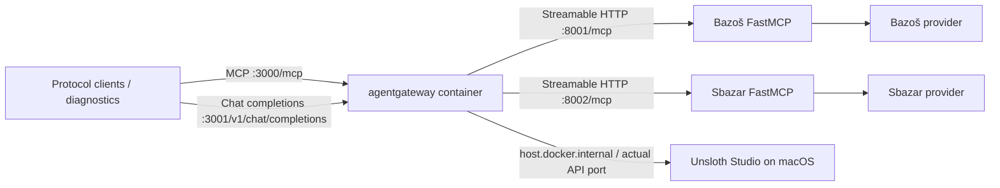
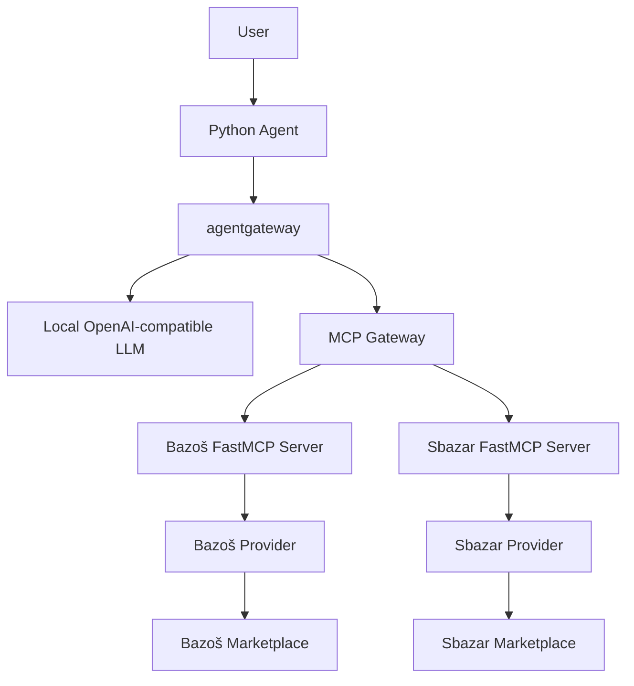

# Architecture

## Current implementation: Stages 01–05

One installable Python package contains the native-tool-calling Python LangChain agent, existing
configuration/diagnostics CLI and health server plus independent Bazoš and Sbazar FastMCP
services. `app`, `bazos-mcp`, and `sbazar-mcp` share the existing multi-stage Dockerfile
and locked Python dependencies. All run as UID 10001 with Compose init and graceful
termination. Only the health port is published on host
loopback along with gateway ports 3000, 3001 and 3002. Upstream MCP is internal at
`http://bazos-mcp:8001/mcp` and
`http://sbazar-mcp:8002/mcp`. MCP healthchecks use actual tool discovery.

The module entry point and console entry point still call `cli.main`. Pydantic Settings
validates environment variables and optional `.env`; help/version work with invalid
configuration. Package metadata supplies the version. `health.py` uses only the standard
library and handles SIGINT/SIGTERM; `/health` reports process responsiveness without
probing external services. Offline CLI diagnostics remain independent of MCP and marketplace access.

| Module | Responsibility |
| --- | --- |
| `cli.py`, `config.py`, `health.py` | Agent CLI, independent diagnostics, settings, health lifecycle |
| `agent.py`, `agent_runtime.py` | LangChain `create_agent`, tools, middleware, per-invocation context and bounded history |
| `agent_tools.py`, `llm.py`, `results.py` | MCP discovery/validation, LangChain model adapter, gateway transport and factual aggregation/rendering |
| `domain/models.py` | Shared `SearchRequest` and `Listing` Pydantic models |
| `providers/bazos.py` | Independent HTTP integration, URL/card parsing, filters/sorting |
| `providers/sbazar.py` | Independent JSON adapter, access checks, unsupported-geography warning |
| `providers/common.py` | Existing Bazoš robots and price filter/sort helpers reused by both providers |
| `mcp/bazos_server.py` | Exactly one `search_listings` tool, Streamable HTTP on 8001 `/mcp` |
| `mcp/sbazar_server.py` | The equivalent single-tool schema, Streamable HTTP on 8002 `/mcp` |
| `mcp/healthcheck.py` | Readiness through MCP discovery, without marketplace requests |
| `config/agentgateway.yaml` | Read-only native gateway config; two MCP targets and one local LLM model |
| `gateway_check.py` | Explicit readiness, MCP discovery/invocation and direct/proxied LLM diagnostics |

The fourth Compose service is the official agentgateway v1.7.0 Docker image, pinned by
version and manifest digest, with native ARM64 verified on Docker Desktop. It uses the
existing default network and service discovery. MCP federation is stateless, always
prefixes tools by target name, and skips unavailable targets (`failOpen`); missing targets
remain visible as failures in diagnostics. No marketplace tools or providers are modified.

The LLM listener serves only the exact `UNSLOTH_MODEL` name. A custom provider advertises
Chat Completions and forwards to `UNSLOTH_BASE_URL` with an optional environment-sourced
Bearer token. Native timeouts use `LLM_TIMEOUT` seconds. MCP has no LLM dependency.
The separate read-only UI listener is port 3002; the admin socket stays on container
loopback at 15000 and native readiness is internal at 15021. No database is configured.
See [gateway operations and verification](agentgateway.md).

The provider accepts a validated request and optionally an httpx client, which makes
HTTP behavior testable without FastMCP or network access. It checks operator permission
and robots before fetching one global search page. A 15-second timeout bounds requests;
there are no retries, caching, detail-page requests, geocoding, or ranking infrastructure.
Only listing summaries are parsed. Price bounds are rechecked locally. Relevance keeps
source order; price sorting precedes the result limit. Geographic responses warn about
unverifiable exact distances and reject unconfirmed postcode/radius form values.

Sbazar uses the same `SearchRequest`, `Listing`, inclusive price filtering and stable
sorting before the final limit. Its source-specific adapter requests one JSON page of
up to 60 summaries from the reference endpoint. Missing descriptions are nullable in
the shared listing model; Bazoš retains its established empty-string behavior.
Sbazar locality/strict radius cannot be verified and return empty listings with a
warning before HTTP; no additional geographic system is introduced.

Live searches on both sources are currently restricted by policy and default to
disabled. Sbazar's reference endpoint and live filter behavior remain unverified.
See [Bazoš MCP](bazos-mcp.md) and [Sbazar MCP](sbazar-mcp.md). An empty result with a
warning differs from a successful empty search. Tests use fixture HTML/JSON, httpx
mocks, and MCP clients/ASGI transport, including equality of both tool schemas.

## Agent flow

The Stage 05 LangChain agent connects both protocol endpoints through the existing Stage 04 gateway.
The model chooses tools through native Chat Completions tool calls, and the agent executes
only approved runtime-discovered identities. See [agent.md](agent.md) for the sequence,
bounded orchestration, error handling, history and aggregation details.
LangChain manages the loop and native message pairing; custom middleware enforces the
existing marketplace rules. Its internal LangGraph dependency requires no new service,
custom graph, database or persistence. Runtime-discovered tools retain their MCP schemas.

The MCP Gateway node is agentgateway routing, not an additional deployment. Stage 04 adds
the gateway and host-model proxy. Stage 05 implements Python user interaction, runtime
discovery, native tool calling and result handling with tests. Stage 06 final integration
and submission work remains planned. The agent never calls Unsloth, marketplace services
or providers directly; no new infrastructure is introduced.

Providers stay independent of MCP and the agent. Add shared services only
when concrete reuse warrants them; avoid speculative contracts and base classes.
`MARKETPLACE_MODE` never selects fake results. Service URLs are syntax-checked; online
`doctor` probes only gateway endpoints, and `--offline` skips network checks.
Each marketplace permission flag controls only its source
access; neither bypasses robots restrictions or affects MCP readiness.
