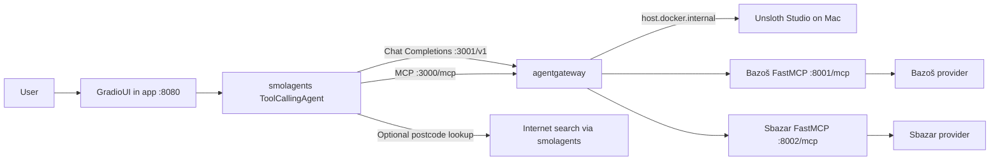

# Architecture

One Python package and four existing Compose services implement the project. The app is
web-only: the standard **smolagents GradioUI** drives **ToolCallingAgent**. No custom
frontend, interactive CLI, database, Node build or code-execution agent is included.

`app`, `bazos-mcp` and `sbazar-mcp` share the existing locked, non-root Python Dockerfile.
agentgateway remains pinned to v1.7.0 and its digest. Host ports bind to loopback; MCP
upstreams are internal. Compose refreshes gateway connections after MCP rebuilds.
The app healthcheck requests the actual Gradio page, independent of model/source readiness.

`config.py` loads environment variables over optional `.env` and defaults. `__main__.py`
starts only the web UI. `agent.py` supplies the thin marketplace-specific wrappers around
the framework's native tool loop. `llm.py` routes only to the configured gateway/model.
`agent_tools.py` discovers and validates actual MCP identities/schemas. `results.py`
reuses common price filtering/sorting and adds source attribution and final limits.
`postcodes.py` supplies a built-in web-search wrapper for missing postcodes; only codes
grounded in an unambiguous lookup or supplied by the user may enter the MCP location field.
`gateway_check.py` retains gateway contract/integration-check helpers without a CLI.

The existing `SearchRequest` and `Listing` remain the shared contract. Providers stay
independent of the agent and MCP transport. They fetch bounded summaries, enforce source
permissions/robots, filter prices and sort before limits. No new marketplace scraping is introduced.
Bazoš exact distances are unverified; Sbazar geographic filters return no listings and an
explicit warning. Disabled/unavailable sources are not presented as successful empty searches.

See [agent.md](agent.md) for the native tool sequence and limits, [agentgateway.md](agentgateway.md)
for routing, and [development.md](development.md) for the VS Code and Docker workflow.
