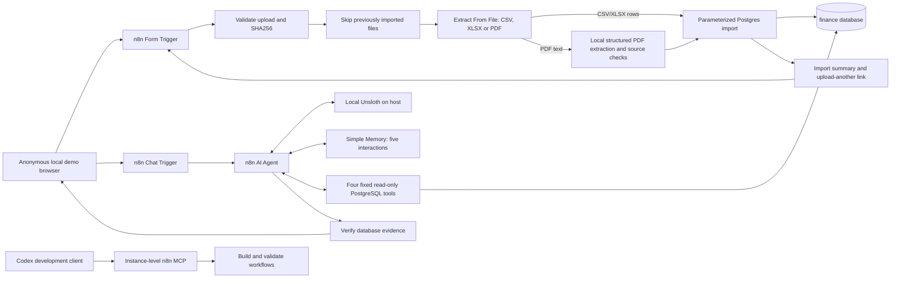

# Assignment 02 — AI Finance Assistant

Stage 02 implements two real n8n workflows over a dedicated PostgreSQL finance
schema and the existing local Unsloth endpoint. No cloud model, bank integration,
custom frontend, or application microservice is used. Assignment 01 is independent
and its files are unchanged.

## Original assignment

> Tvorba no-code agenta
>
> Navrhni a vytvoř agenta v libovolné “No code” platflormě, který pracuje s databází, používá nástroje a odpovídá na dotazy přes LLM.
>
> No code platformy:
> - N8N
> - LangFlow
>
> Formát: JSON soubor s definicí workflow pro N8N a LangFlow
>
> Deadline: 23. 11. 2026 23:59
>
> Maximální počet bodů: 100 bodů.

Selected platform: **n8n**.

## Purpose and stack

Upload CSV/XLSX statements or text PDFs, categorize recognized transactions,
and ask Czech financial questions calculated from stored transactions.

| Component | Actual version / location | Responsibility |
| --- | --- | --- |
| n8n | `docker.n8n.io/n8nio/n8n:2.46.6` | Forms, file extraction, AI Agent, tools, chat |
| PostgreSQL | `postgres:17.11-bookworm` | Exact arithmetic, validation, deduplication, storage |
| Unsloth | Existing host installation, OpenAI-compatible API | Local inference and native tool calling |
| Codex + built-in n8n MCP | Existing OAuth connection | Development, schema discovery, validation and workflow changes |

The model selection was obtained from the configured endpoint's `/models` list;
it is configurable in the **Local Unsloth Model** and **PDF Local Model** nodes. The current local model is
`unsloth/Qwen3.5-9B-GGUF`. Its name is configuration, not an assumed cloud default.

## Architecture



MCP is a **development interface used by Codex**. The running assistant does not
connect to MCP: its tools are four native Postgres Tool subnodes attached through
`ai_tool` connections. The LLM chooses tools and parameters; fixed parameterized SQL
queries execute only when the agent calls them. Whole tables are never placed in
the prompt. No subworkflows or community packages are needed.

## Start and initialize

Preserve the existing `.env`, encryption key, Docker volumes, owner login and MCP
consent from Stage 01. From the repository root:

```bash
cd 02
docker compose up -d --wait --wait-timeout 180
node config/setup-finance.mjs
```

For a new deployment only, create `.env` first as described in
[development.md](docs/development.md), complete n8n owner setup, and configure the
existing local Unsloth API in `.env`:

```dotenv
UNSLOTH_BASE_URL=http://host.docker.internal:8888/v1
UNSLOTH_MODEL=<exact ID returned by your local /models endpoint>
UNSLOTH_API_KEY=<your local API key>
```

The real configured endpoint here is `http://host.docker.internal:8888/v1`.
The existing key from Assignment 01 was verified and copied privately into
`02/.env` with the user's authorization; it is absent from workflow exports.
After changing environment settings, run `docker compose up -d n8n`, then:

```bash
docker compose exec -T n8n node /opt/finance/verify-unsloth.mjs
node config/setup-finance.mjs --credentials-only
```

Setup applies the reproducible migration, creates the restricted reader role, and
imports encrypted n8n credentials through the official Server CLI. MCP has no
credential-creation operation. Secrets travel over stdin and a temporary mode-0600
container file, which is removed after import; no decrypted credentials are exported.
Host Node 22 is needed for these administrative and test scripts, not for runtime.

For a first-ever environment, the Stage 01 environment generator remains available:

```bash
docker run --rm --entrypoint node \
  --mount "type=bind,src=$PWD,dst=/project" --workdir /project \
  docker.n8n.io/n8nio/n8n:2.46.6 config/create-env.mjs
```

It refuses to overwrite `.env`. Compose still uses only the two existing services.
PostgreSQL has no published host port; n8n publishes only `127.0.0.1:5678`.
The VS Code **Finance: Start n8n** debug profile remains available.

## Database

`database/init/10-create-databases.sql` preserves Stage 01 database isolation.
`database/001-finance.sql` creates the following in the dedicated `finance` database:

| Object | Purpose |
| --- | --- |
| `finance.accounts` | Personal logical account per supported currency |
| `finance.categories` | Eleven named categories |
| `finance.transactions` | Signed `NUMERIC(18,2)` amounts, dates, merchant, category, source ID, deduplication key |
| `finance.imports` | SHA256 file hash, counts, status, bounded validation errors; no statement body |
| `finance.categorization_rules` | Ordered merchant regular expressions |
| `finance.ledger` | Read-only reporting view with income, net spending and net balance |

Primary keys, foreign keys, sign/currency checks, unique file hashes and transaction
keys enforce consistency. Indexes cover dates, category/date, merchant and bank IDs.
All sums and averages execute in PostgreSQL. Monetary results travel to the model
as decimal strings. No floating-point database columns or JavaScript money sums.

**Sign convention:** incoming is positive; outgoing is negative. `expense` must be
negative, `income` and `refund` positive; `transfer` can have either sign. Refunds
reduce spending in their booking month and original merchant category. Explicit
transfers are excluded from income, spending and net balance. Transfers are identified
only through the optional `transaction_type` column, never guessed from an amount.
Positive rows without a type default to income; mark refunds explicitly.

The importer uses `finance_app` in the application database. The agent uses
`finance_reader`, which can select only `finance.ledger`, cannot insert or execute
the import function, has no schema-create rights and has a 10-second statement
timeout. Both credentials are separate from n8n's internal database account.
`database/002-reader.sql` creates the restricted role. No n8n internal tables are
created or edited by this application migration.

Each import is one atomic function call with a transaction advisory lock. Individual
invalid rows are reported while valid rows commit; `partial` makes this explicit.
Unexpected row errors expose only a generic message. At most 100 error details are
retained; invalid counts still cover all rows.

**Deduplication:** bank ID + logical account is preferred, and an identical ID with
changed financial data is rejected. Without an ID, SHA256 covers account, date,
exact signed amount, currency, normalized description, merchant, type and an
occurrence ordinal. Two identical legitimate rows within a statement survive.
Across overlapping statements, indistinguishable identical rows can still collide;
a later independent identical payment cannot be distinguished reliably without a
bank ID. Supply `transaction_id` whenever available. File hashes make identical
uploads idempotent, including CSV/XLSX overlap via their bank IDs.

## Import workflow

**Finance - Import Bank Statement**, ID `ObNXCw6o4NlnPtMm`:
[open workflow](http://localhost:5678/workflow/ObNXCw6o4NlnPtMm).

Open **http://localhost:5678/form/finance-import**. This local demo form is anonymous
and requires no username or password. Choose one file and submit. A direct response
displays file name, processed/imported/duplicate/invalid counts, status and safe errors.
The result includes **Nahrát další výpis**, which returns to the same permanent
form for another upload. There is no need to run the workflow in the editor.

Use the **Production URL** above, beginning with `/form/`. The `/form-test/` URL is
only for an editor test run and stops listening when that test ends. The workflow
must be published once; this instance is already published. Production executions
do not animate the editor canvas. See the [n8n Form Trigger documentation](https://docs.n8n.io/integrations/builtin/core-nodes/n8n-nodes-base.formtrigger/).

Canonical CSV/XLSX header (all six columns required; the last two may be empty):

```text
date,amount,currency,description,merchant,transaction_id
```

An optional seventh column, `transaction_type`, accepts `expense`, `income`,
`refund` or `transfer`. No automatic bank-specific CSV/XLSX column mapping is attempted.

- CSV: UTF-8, optional BOM, comma delimiter, header row; quote decimal-comma amounts
  and any fields containing commas. Malformed CSV is not silently skipped.
- XLSX: sheet named `Transactions`, header row, dates stored as ISO text. Numeric
  amounts and textual Czech amounts work. Excel date serials and arbitrary bank
  layouts are deliberately unsupported.
- PDF: selectable text, with no bank-specific template required. Native Extract From
  File reads the text; one local Unsloth Information Extractor call identifies
  transactions. Dates, signed amounts and copied text are checked against a verbatim
  source excerpt before the existing SQL validation/import. Opening/closing balances
  and totals are excluded. Unsupported rows are reported, not silently accepted.
  Recognition can be incomplete: compare the result with the original statement.
- Dates: strict `YYYY-MM-DD` or `DD.MM.YYYY`, real calendar dates, 1900–2100. Stored
  as `DATE`; no UTC conversion is applied to a booking date. Execution timezone is
  `Europe/Prague`; audit timestamps are `TIMESTAMPTZ`.
- Amounts: optional sign, one dot or comma decimal separator, at most two fractional
  digits; correctly grouped Czech spaces/NBSP supported (`-6 000,00`). Ambiguous
  formats such as `1,234.56`, trailing signs and parentheses are rejected.
- Currency: uppercase `CZK`, `EUR`, `USD`, `GBP`, `PLN`, `CHF`; no FX conversion.
- Text is trimmed with whitespace collapsed. Merchant identity is never invented;
  an empty or unknown merchant defaults to `Other`.
- Limits: one file, 2 MiB upload, 10 MiB declared expanded XLSX content, 5000 rows.
  PDFs additionally allow at most 20 pages, 30000 text characters and 100 recognized
  transactions. Oversized, encrypted, image-only or unrecognized PDFs produce a
  clear error. No OCR or bank API access is implemented. Local PDF parsing can take
  longer than CSV/XLSX; known file hashes skip extraction on repeated uploads.
  PDF extraction permits **32000 output tokens**. The installed Qwen integration
  serializes this native n8n `maxTokens` setting as `max_tokens: 32000`. The
  Information Extractor consumes a complete JSON response; streaming is disabled.
  The PDF model request timeout is **1500 seconds (25 minutes)**; the entire import
  workflow allows **3600 seconds (60 minutes)** so a structured-output repair can
  make a second model request without hitting the former 10-minute workflow limit.
  These limits apply to newly started uploads.

Rules in `finance.categorization_rules` map Lidl/Albert/Kaufland to Groceries,
Netflix/Spotify to Subscriptions, Shell/OMV/DPP to Transport, Alza to Shopping,
and several clearly synthetic merchants to other demo categories. No LLM call per row.

Form Trigger **2.1** is intentionally used: this installed, supported version can
respond through Respond to Webhook. Newer Form completion nodes persist a waiting
execution until the browser resumes it; avoiding that prevents abandoned completion
pages retaining raw statements. This type-version change used documented CLI
export/import because MCP cannot edit a node's type version. The final graph and
actual HTTP uploads were verified again after import. The direct result is HTML
with summary counts and a link to start another upload; it creates no waiting form
execution. PDF rows that fail source verification use a controlled database error
and retain their invalid-row count in the import record.

## AI Agent and Unsloth

**Finance - AI Assistant**, ID `u4woXC4KYKne0clG`:
[open workflow](http://localhost:5678/workflow/u4woXC4KYKne0clG).
Open the workflow's Chat Trigger hosted URL, or use its **Open chat** control:

**http://localhost:5678/webhook/8d4ad2bd-7977-4335-a473-a8f537558bb2/chat**

The local demo chat is anonymous and requires no username or password. The n8n
editor and development MCP retain their own authentication. Both demo endpoints
remain available only through the existing localhost port.

The OpenAI Chat Model 1.3 node uses the **Finance - Local Unsloth** credential's
custom Base URL and API key. Responses API is disabled; native Chat Completions
`tool_calls` and matching tool results remain managed by the genuine n8n AI Agent
3.1. There is no HTTP-only imitation agent or cloud fallback. The selected local
model's thinking mode is disabled for this workflow; generation is bounded and
configured to reduce repeated text. Simple Memory 1.4 keeps five interactions per
session in n8n memory; it is not persistent and resets on restart. A follow-up must
query PostgreSQL again. The local model occasionally skips that query; the evidence
workflow retries at most twice, then returns a safe message with no monetary answer. Earlier tuning runs also
produced repeated text or unsupported extra amounts; the final evidence filter
removes unsupported numeric sentences. These limitations are not hidden by the tests.

| Tool | Fixed operation and parameters |
| --- | --- |
| `get_spending_summary` | Category net spending and total; `start_date`, `end_date`, `currency` |
| `search_transactions` | Merchant/category/type/amount filters, exact totals over all matches and at most 50 rows; adds `merchant`, `category`, `min_amount`, `transaction_type` |
| `get_monthly_summary` | Monthly income, gross expenses, refunds, net spending, balance and calendar-month average; optional `category` |
| `compare_periods` | Two periods' totals, exact changes and spending percentage change; `first_start`, `first_end`, `second_start`, `second_end`, `currency` |

All starts are inclusive and ends exclusive. An empty date filter uses stored
coverage; default currency is CZK. Monthly output is capped at 120 months and marks
truncation. Search truncation does not truncate its SQL-calculated totals. Queries
never accept generated SQL. Category names in tool parameters are English.

A final evidence check rejects answers with no actual tool observation and removes
sentences with unsupported numeric values, including amounts stated as ranges. Tool steps stay internal to the workflow in
normal use. This is a practical safeguard, not a formal proof of arbitrary prose;
small local models can still choose an unsuitable tool, associate a known amount
with the wrong month, or produce awkward wording.
No fabricated fallback amounts are returned.

Example questions:

- „Za co jsem v říjnu 2026 utratil nejvíc?“
- „A kolik z toho bylo za potraviny?“
- „Kolik jsem měl příjmů v říjnu 2026?“
- „Jaké byly měsíční příjmy a výdaje za září až listopad 2026?“
- „Jaká byla moje největší výdajová transakce v říjnu 2026?“
- „Kolik peněz jsem utratil v Alze?“
- „Porovnej výdaje za září 2026 a říjen 2026.“
- „Najdi transakce nad 2000 Kč.“
- „Za co bych mohl nejvíc ušetřit?“

## Privacy and retention

Inference uses only the configured local endpoint. Do not configure an external
provider, publish through a tunnel, or place real statements/pin data in Git.
The demo form and chat allow anonymous access on localhost at the user's request.
The development client/provider can receive MCP tool results: use synthetic data
for development. `.env`, private inputs, backups and unreviewed exports are ignored.
Credentials live encrypted in n8n; preserve `N8N_ENCRYPTION_KEY` with secure backups.

Workflow and instance settings disable saved success/error/manual execution data
and progress. n8n **temporarily writes execution data and binary files during runs**,
then soft-deletes unsaved executions; physical pruning is asynchronous. Hard-delete
buffer is zero and pruning runs every minute. A 24-hour / 100-execution cap is an
additional fallback for saved history. This is not secure erasure of disk blocks,
WAL, host snapshots or backups. Do not pin real financial executions or leave manual
waiting executions. Import summaries retain only file name/hash, counts and safe
row errors, never the original statement. Conversation memory contains recent chat
content and tool results in process memory and is lost on restart.

## MCP development and workflow deliverables

Development connected through the existing authenticated MCP server, listed the
initial empty workflows/credentials, discovered exact installed node schemas,
validated SDK graphs and created both workflows in the owner's **personal project**.
The SDK reference and relevant design guidance were read before creation. MCP
performed edits, validation, publication and a real chat execution. Multipart file
uploads and session-controlled multi-turn chat were tested through the actual
native HTTP endpoints because MCP inputs cannot carry binary files or a session ID.
Server CLI handled credential creation, export/import and the trigger-version edit.
See [MCP connection setup](docs/codex-mcp.md) and
[official Server CLI](https://docs.n8n.io/hosting/cli-commands/).

Regenerate the two exports with `node config/export-workflows.mjs` after changing
these local workflow IDs if you imported into another instance. Actual sanitized n8n exports:

```text
workflows/finance-import.json
workflows/finance-agent.json
```

Import using n8n **Import from File**. On a clean compatible n8n instance (tested
version 2.46.6), create/reassign these credentials independently:

| Credential name | Type | Configuration |
| --- | --- | --- |
| Finance - Import Database | Postgres | `postgres:5432`, finance database, finance_app password from `.env`, SSL disabled on this private Docker bridge |
| Finance - Read Only Database | Postgres | Same server/database, `finance_reader`, FINANCE_READER_PASSWORD |
| Finance - Local Unsloth | OpenAI | Custom local Base URL, local API key; choose exact installed model ID in model node |

Attach Import Database to both import PostgreSQL nodes; attach Read Only Database
to all four agent tools. Assign Local Unsloth to the chat model and the PDF model. Both demo triggers use
Authentication = None. Exports omit secret values and pin data and import as inactive. Review local endpoint/model and paths,
then publish. Workflow IDs/webhook IDs can change on a new instance; use the URLs
shown by the imported triggers. There are no external subworkflow ID dependencies.

## Testing and results

Synthetic fixtures are in `examples/`: canonical CSV (43 rows, 42 unique), XLSX
(the same rows plus one new transaction), a bank-style PDF (three overlapping
transactions and one new November payment), an empty-text PDF, invalid amount/date
CSV, and missing-column CSV. They cover September–November 2026, income, refunds, transfers, eleven category
seeds and distinct bank IDs for two otherwise identical purchases. No real bank data.

```bash
# Run from 02 after setup, workflow import and publication.
node tests/imports.mjs
node tests/tools.mjs
node tests/evidence.mjs
node tests/pdf-evidence.mjs
docker compose exec -T postgres sh -c \
  'psql -U "$FINANCE_DB_USER" -d "$FINANCE_DB_NAME" -v ON_ERROR_STOP=1' < tests/database.sql
```

`tests/chat.mjs` is the diagnostic acceptance harness: run it against the real chat
with `exposeTestEvidence = true` temporarily set in **Return Verified Answer**
and the workflow republished. Run `node tests/chat.mjs`, then restore `false` and
publish again. Use synthetic data only. It
compares the complete October category result with an independent SQL query over
base tables, checks actual calls and amounts, and exercises one multi-turn session.
The application normally hides intermediate steps through its evidence node.
Recorded synthetic evidence is in `tests/acceptance-results.json` and the final
verification record is [docs/verification.md](docs/verification.md).

First-run imports: CSV **42 inserted / 1 duplicate**; XLSX **1 inserted / 43 duplicates**.
PDF **1 inserted / 3 duplicates**. Repeated imports insert zero. The final demo
database contains **44 transactions** after all three supported formats. Regenerate
the synthetic PDFs with `node config/create-pdf-examples.mjs` if needed.
Invalid amounts, impossible dates and missing columns are explicitly reported.
Constraint, NUMERIC, FK, reader privilege, normalization and fallback-dedup tests
pass inside a rollback transaction.

Independent October 2026 oracle: Housing **14,000.00 CZK**, Shopping **5,000.00 CZK**,
Groceries **2,720.75 CZK**, Restaurants **1,010.00 CZK**, Transport **780.00 CZK**,
Subscriptions **468.00 CZK**, Entertainment **300.00 CZK**, Healthcare **240.00 CZK**.
Net spending **24,518.75 CZK**, gross expenses **25,518.75 CZK**, refunds **1,000.00 CZK**,
income **45,000.00 CZK**, net balance **20,481.25 CZK**. Transfers are excluded.

## Limitations and assignment compliance

This is a local single-user teaching application. It supports one logical account
per currency, canonical CSV/XLSX and heuristic text-PDF extraction, explicit
transfer/refund labels, and no
FX conversion. It cannot certify statement completeness. Refunds are recognized
in their booking month; cross-month matching to purchases is not attempted.
Missing bank IDs have the documented fingerprint ambiguity. Search returns at most
50 detailed rows, monthly output at most 120 months. The evidence guard cannot
prove every semantic claim in free text; inspect results for consequential decisions.
PDF recognition is bank-agnostic and approximate, not a guaranteed parser for every
bank layout. Source checks cannot prove that every original row was recognized.
Scanned/image-only and password-protected PDFs are unsupported. No forecasting,
investment/tax advice, OCR, vector database or bank API is included.

The deliverable demonstrates the assigned no-code platform, a genuine AI Agent,
local LLM, database access, actual tool execution, Czech natural-language answers,
conversation context, reproducible SQL and importable exported workflow JSON.
The existing Stage 01 operational guides retain additional startup, backup and
recovery detail; Stage 02 behavior is described in this README and final test record.
