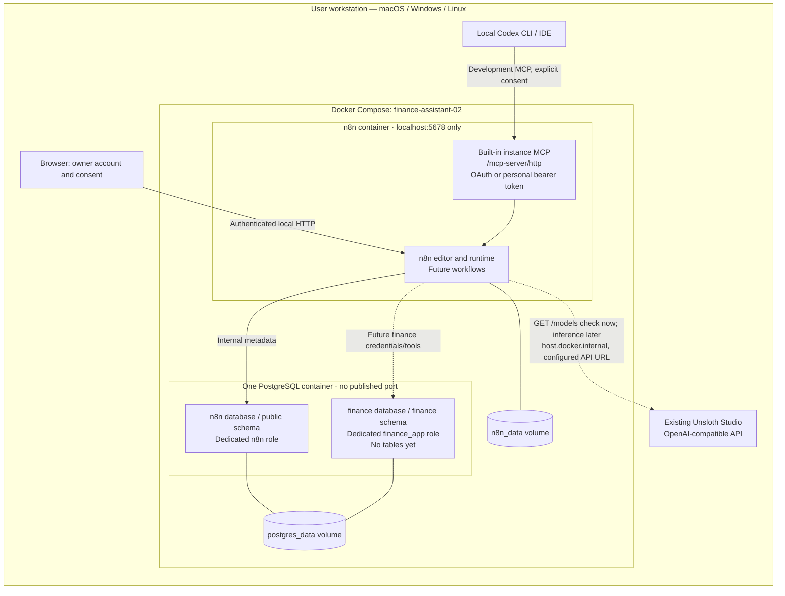

# Architecture

Stage 01 deploys infrastructure only. Assignment 01 has a separate Compose project
and is neither referenced nor modified by this deployment.

## Runtime and development connections

Codex connects to the **instance-level MCP server** to inspect, build, validate,
and test workflows within granted permissions. It does not become the Finance
Assistant. The MCP Server Trigger workflow node is a different feature and is not
needed for this connection.

Future agent tools will be workflow nodes or scoped subworkflows querying the
finance database. The future agent will call the user-configured local Unsloth API
for inference. No tools, agent, model download, or inference workflow exist yet.
The only current Unsloth request is an explicitly invoked models-list check.

## Storage and identity boundaries

One PostgreSQL server hosts two application databases, each owned by a separate
non-superuser. Revoking public database privileges prevents cross-database access
by those roles. The bootstrap account is used only for administration and initialization.
The finance database has an empty `finance` schema and a finance-only search path.

n8n's official migrations create internal tables in its own database. The `.n8n`
directory still needs a persistent volume for instance files. Its stable encryption
key comes from the private `.env`; backups must preserve both data and that key.
Logical database separation is not encryption at rest or isolation from the host
administrator. Docker Desktop and host disk protections apply to local storage.

## Network and security boundaries

A dedicated Compose bridge connects n8n and PostgreSQL. The editor and MCP publish
only on `127.0.0.1`; PostgreSQL has no host publication. `N8N_HOST` advertises a URL
and does not control this bind restriction. Host-side port changes also update
the editor and webhook URLs, while container port `5678` remains fixed.

The bridge permits outbound host connections. Docker Desktop provides host routing;
the explicit `host-gateway` entry provides the corresponding hostname on Linux.
Host model binding/firewall requirements differ by operating system; see the README.
No tunnel, reverse proxy, public domain, external MCP server, or Docker socket is used.

n8n authentication and secure-cookie defaults remain enabled. Diagnostics and
remote templates/update notifications are disabled following the
[official isolation settings](https://docs.n8n.io/hosting/configuration/configuration-examples/isolation/).
Environment and n8n configuration file access from workflow nodes is blocked;
community package installation is disabled. Default restrictions on command
execution and file access are not loosened.

The project configures no cloud LLM credential, bank-data fixture, or automatic
transmission. These configuration boundaries are not an outbound network allowlist.
Use synthetic data for development and avoid exposing sensitive execution data to
Codex or another MCP client. Grant MCP permissions deliberately and revoke clients
when they are no longer needed.

## Lifecycle

PostgreSQL's TCP readiness gate completes after entrypoint initialization. n8n
starts only after the database healthcheck succeeds and reports its own database-aware
readiness via `/healthz/readiness`. Both services restart unless explicitly stopped;
grace periods allow shutdown without arbitrary startup sleeps. Docker marks an
unhealthy container but does not automatically restart it solely for being unhealthy.
`depends_on` gates startup; it is not continuous failover orchestration.
