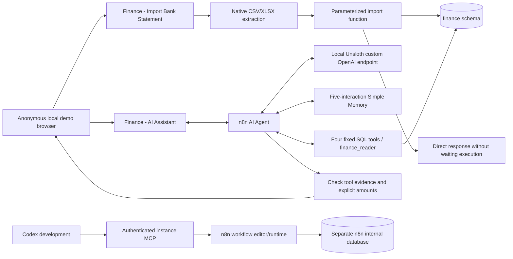

# Architecture

Stage 02 adds two native n8n workflows to the existing two-service Stage 01
infrastructure. Assignment 01 is independent and its files are unchanged.

Codex uses instance MCP to discover node schemas, validate SDK graphs, and create,
update, publish and test workflows. The running assistant does not use MCP. Native
Postgres Tool subnodes execute parameterized queries selected by the local model.
MCP cannot create credentials, transport uploaded binary files or set a chat session
ID, so supported Server CLI operations and actual HTTP triggers cover those tasks.

The finance owner is separate from the n8n database login. The agent's restricted
`finance_reader` can select only a reporting view. Database arithmetic uses NUMERIC;
positive incoming and negative outgoing amounts are explicit. Refunds reduce spending,
and labeled transfers do not count toward income, spending or net balance.

Only n8n publishes a host port, bound to IPv4 loopback. PostgreSQL is reachable only
on the project Docker bridge. Host Unsloth is accessed via `host.docker.internal` and
an encrypted n8n credential. There is no cloud model fallback or external agent tool.
The bridge is not an egress firewall. The existing n8n owner login and MCP OAuth are
preserved; form/chat allow anonymous access for this local demo.

Successful/error/manual execution data is disabled and physically pruned asynchronously
at one-minute intervals with no hard-delete buffer. Running executions can temporarily
write data/binaries to disk. Direct form responses avoid abandoned waiting executions.
Short chat memory exists only in the n8n process. See the README for exact privacy
limits, the database schema, import fingerprint ambiguity, and local-model reliability.

The official image's internal JavaScript task runner is used; no host filesystem,
Docker socket, external runner, vector database or application service is added.
For production isolation, an external task runner would require a separate deliberate
architecture change outside this assignment. Backups must protect the finance and
n8n volumes plus the matching encryption key; storage is not application-level encrypted.
